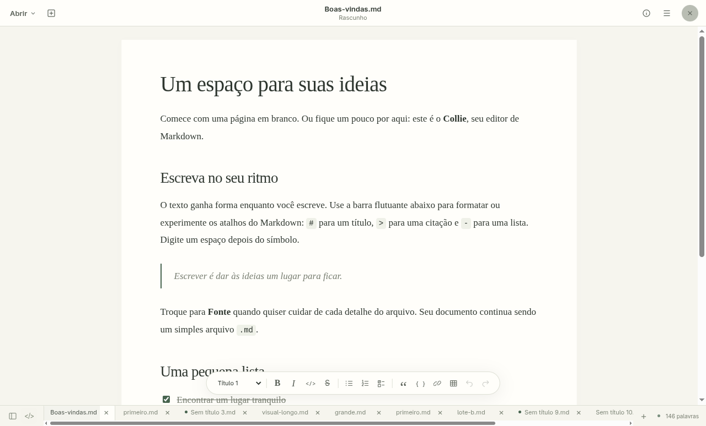
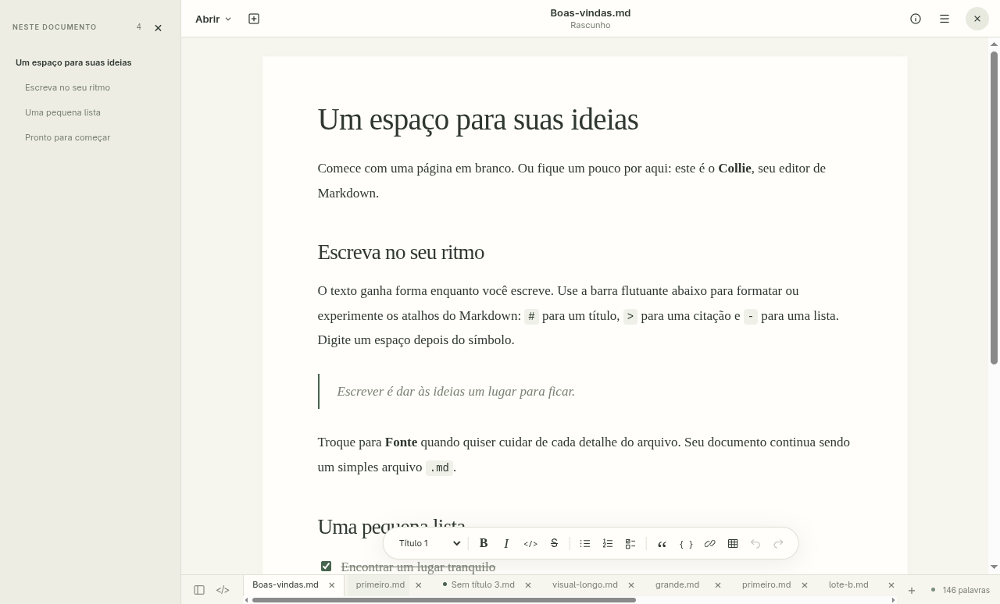
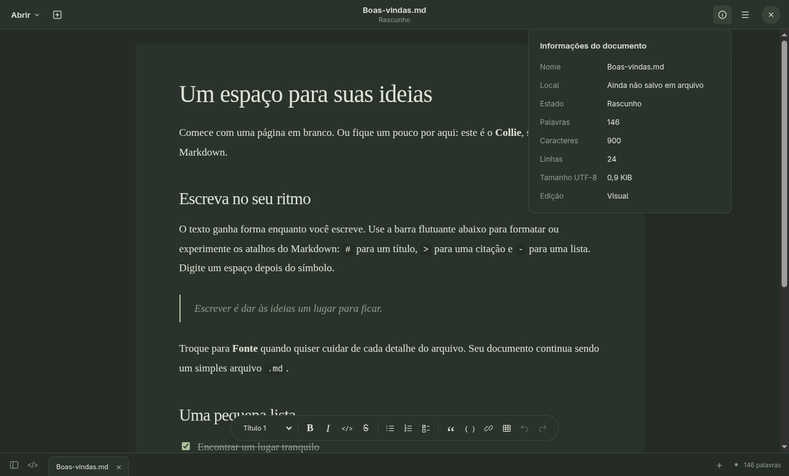

# Cabeçalho e navegação do Collie

21/10/2026. Implementação baseada na captura do GNOME Text Editor enviada pelo usuário: Abrir com seta, novo documento, título com estado abaixo, informações, menu principal e fechar janela.

| Elemento da referência | Comportamento no Collie |
|---|---|
| Abrir ▾ | Abre um menu com seleção de arquivos e busca pelos documentos já abertos nesta sessão. Selecionar um documento existente ativa sua aba preservando o estado. Ctrl+O continua abrindo o diálogo diretamente. |
| Ícone de novo documento | Cria e foca uma nova aba, preservando os outros documentos. Ctrl+N e Ctrl+T continuam disponíveis. |
| Título central e estado | Mostra o nome, indicador de alterações e subtítulo Rascunho / Salvo no dispositivo / Alterações não salvas. O caminho completo está disponível no tooltip e nas informações. |
| Informações ⓘ | Mostra nome, caminho, estado, palavras, caracteres Unicode (pontos de código), linhas, tamanho UTF-8 do texto e modo de edição. A indexação ocorre no worker; dados desatualizados mostram Calculando. O tamanho descreve o texto atual, não o tamanho físico do arquivo original com eventual BOM. |
| Menu ☰ | Reúne salvar, salvar como, buscar, navegar por títulos, alternar modo, foco, exportar HTML/PDF, tema, fechar aba e ajuda. A identidade Collie permanece no item de ajuda e no ícone do aplicativo. |
| Fechar × | Fecha a janela pela ponte IPC específica, com validação de origem. A confirmação existente protege alterações em todas as abas. O controle não aparece no fallback de navegador. |

A lateral começa recolhida. Ela contém apenas o sumário virtualizado e o botão de ocultar, sem logo, cartão de documento, Novo/Abrir, tema ou texto promocional. Pode ser aberta pelo botão de estrutura no rodapé ou pelo menu principal. Clicar em um título navega até esse trecho. As abas inferiores e a barra de formatação flutuante continuam disponíveis.

Os menus podem ser usados pelo teclado, fecham ao clicar fora ou pressionar Esc e são limitados à altura da janela. O menu Abrir lista a sessão atual; não há histórico persistente de arquivos recentes nem recuperação automática de rascunhos após reiniciar.

## Validação

`npm test` executado em Linux com Electron real e Playwright. Resultado estruturado: [testes-header.json](testes-header.json). A suíte verifica 14 grupos, incluindo:

- Menu Abrir, filtro e ativação de documentos existentes; criação pelo botão do cabeçalho e gravação pelo menu principal.
- Informações do documento e estado inicial de rascunho; cabeçalho com lateral recolhida.
- Lateral exclusivamente de navegação, estado acessível do botão e layout na largura mínima de 820 pixels.
- Fechar janela pelo botão do cabeçalho com alterações em abas inativas, cancelando sem perder texto.
- Painéis dentro dos limites da janela, temas claro e escuro e ausência de exceções JavaScript.
- Regressões anteriores de abas, exportação PDF e edição/gravação integral de arquivos de 1,2 MB e 18,3 MB.

Os diálogos nativos usam respostas controladas e os arquivos de teste ficam em `work/collie-test`. Esta mudança não foi empacotada nem validada em Windows.

## Capturas do aplicativo

