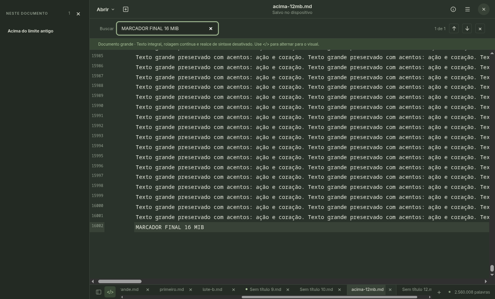
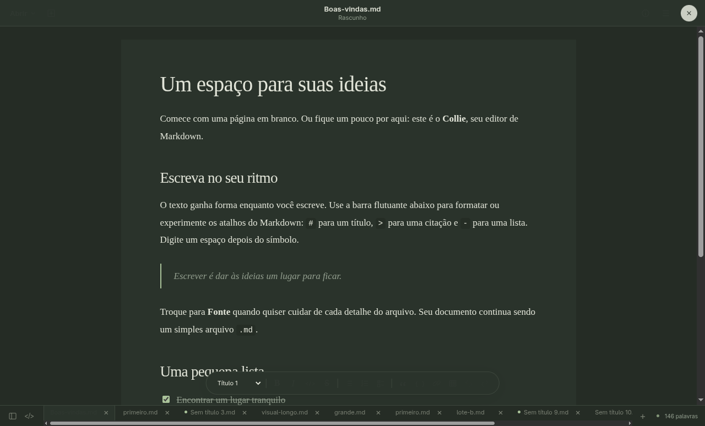

# Investigação do GNOME Text Editor e adaptação ao Collie

A adaptação posterior do cabeçalho e da lateral está em [HEADER-COLLIE.md](HEADER-COLLIE.md), com resultado atual em [testes-header.json](testes-header.json). As capturas abaixo mostram a interface atualizada.

Data: 21/10/2026. Referência confirmada pelo usuário: Editor de Texto do GNOME/Ubuntu.

## Evidências da referência

A investigação consultou documentação oficial e código público. Não foi feita uma sessão de testes de desempenho do aplicativo GNOME instalado. As conclusões sobre sua implementação abaixo são inspeção de fontes, não medições comparativas.

| Aspecto | Evidência verificável | Aplicação no Collie |
|---|---|---|
| Layout compacto | [Página oficial e imagens](https://apps.gnome.org/TextEditor/), [imagem oficial da janela](https://static.gnome.org/catalog/app-screenshot/org.gnome.TextEditor/image-1_orig.png) e [estrutura da janela](https://github.com/GNOME/gnome-text-editor/blob/main/src/editor-window.ui): cabeçalho, ações de documentos, área de edição e componentes de abas. | Cabeçalho com Abrir, botão de novo documento, título central e ações à direita. Mantida a identidade Collie, abas inferiores e formatação flutuante definidas no projeto. |
| Criar documento | [Manual: criar arquivo](https://help.gnome.org/gnome-text-editor/basics-create-new-file.html): botão Nova aba e Ctrl+N. O documento começa como rascunho, com persistência automática própria do GNOME. | Novo sempre cria outra aba, com foco imediato no texto. Ctrl+T acrescentado. Rascunhos ficam disponíveis ao alternar abas na sessão; persistência automática entre sessões não foi implementada. |
| Abrir documentos | [Manual: abrir arquivos](https://help.gnome.org/gnome-text-editor/basics-open-file.html): Abrir no cabeçalho, Ctrl+O e seleção de vários arquivos no mesmo diálogo. | Seleção múltipla via Electron e fallback de navegador. Cada documento válido recebe sua aba; erros individuais são reunidos em um diálogo, sem descartar os arquivos válidos. |
| Navegação por abas | [Diretrizes de abas](https://developer.gnome.org/hig/patterns/nav/tabs.html): conteúdo variável na mesma janela, rótulos curtos e atalhos de navegação. | Preservadas abas inferiores, nome abreviado, caminho no tooltip, estado de alteração e botão de fechar. Adicionados Alt+1–9 e fechamento pelo botão do meio; mantidos Ctrl+Tab, Ctrl+Shift+Tab e Ctrl+W. |
| Arquivos grandes | [Código de EditorDocument](https://raw.githubusercontent.com/GNOME/gnome-text-editor/main/src/editor-document.c): macro `IS_LARGE_FILE` em 1 MiB; na conclusão de carregamento desativa realce, correspondência de colchetes e corretor para esses buffers. Usa GtkSourceBuffer e carregamento assíncrono com GtkSourceFileLoader. | CodeMirror mantém o documento inteiro e virtualiza a região visível. Em documentos grandes, parser Markdown, correspondência de colchetes, realce de ocorrências e quebra automática são desativados. Histórico, seleção, edição, busca e gravação continuam disponíveis. |

O [README oficial](https://github.com/GNOME/gnome-text-editor) também documenta gestão de sessões, busca/substituição com expressões regulares, correção ortográfica, impressão, temas, `.editorconfig`, modelines e modo Vim. Esses recursos não foram todos portados: o foco solicitado foi documentos grandes, layout e abas. A restauração automática do GNOME tem comportamento diferente da preservação em memória do Collie.

## Decisões da implementação

O Collie já tinha múltiplas abas, CodeMirror virtualizado e indexação em worker. A adaptação reforça essa estrutura. A página externa permanece limitada à janela; existe um viewport vertical do documento, sem paginação e sem criar outras janelas para novos arquivos. No modo Fonte grande pode haver rolagem horizontal para linhas compridas.

O limite anterior de leitura/gravação era 12 MiB no Electron e 8 MiB no fallback de navegador. Ambos passam a aceitar até 64 MiB por arquivo. Isso é um limite de entrada, não uma promessa de desempenho em 64 MiB. Há leitura integral e cópias em memória durante IPC, edição e gravação; não há leitura incremental do disco. A exportação continua limitada a 24 MiB de HTML.

A estratégia grande continua sendo acionada com mais de 200.000 caracteres ou 3.000 quebras de linha. Os limiares são decisões próprias do Collie. O modo visual continua disponível com confirmação e não é virtualizado como a Fonte. O componente `Compartment` permite trocar os recursos do CodeMirror sem perder o histórico ao ultrapassar o limiar durante a edição.

Abertura mantém validação de origem IPC, autorização de caminhos pelo diálogo e isolamento do renderer. UTF-8 inválido passa a ser recusado em vez de substituir caracteres silenciosamente. Gravação mantém temporário e substituição. O botão Fonte foi corrigido para alternar nas duas direções. As ações de arquivo exibem estado de operação e evitam duplicação enquanto pendentes.

## Validação realizada

`npm ci --include=dev`, instalação do runtime Electron, `npm run build` e `npm test` executados em Linux, usando Electron 44.7.2 real e Playwright. Resultado completo: [testes-gnome.json](testes-gnome.json), com treze grupos aprovados e nenhuma exceção JavaScript.

- Arquivo de 1.213.829 bytes, 12 mil seções: abertura até ativação da aba em 57 ms, índice de 12.001 títulos, DOM virtual limitado, busca e fim acessíveis, gravação integral conferida.
- Arquivo UTF-8 de 18.256.046 bytes (18,3 MB / 17,4 MiB): fim acessível, edição e gravação comparadas integralmente, busca do marcador final, restauração de rolagem e desfazer após troca de abas.
- Seleção múltipla contendo dois textos válidos e um binário: duas abas novas, erro identificado e documentos existentes preservados.
- Arquivo acima de 64 MiB e texto UTF-8 inválido: recusados sem criar abas.
- Documento que cresce além do limiar durante edição: reconfiguração otimizada e desfazer preservados.
- Novo/Abrir conservam rascunhos; cancelar fechamento e proteção de alterações em abas inativas continuam funcionais.
- Ctrl+T, fechamento pelo botão do meio, alternância Fonte/Visual pelo botão, PDF, tema escuro, janela mínima e ausência de rolagem duplicada verificados.

Os diálogos nativos foram substituídos por respostas controladas; leitura e gravação foram reais em arquivos sintéticos de `work/collie-test`. As medições são locais. Não foram medidos todos os tamanhos até 64 MiB, inúmeras abas grandes, todos os dialetos Markdown ou comportamento após falha de energia. Esta alteração não foi empacotada nem validada em Windows; os resultados Windows de 15/10 são históricos.

## Capturas verificadas

Layout atual com abas inferiores e novo cabeçalho:

Arquivo de 18,3 MB, último trecho acessível na mesma janela:

Tema escuro:

